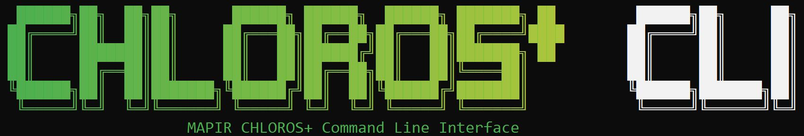

# Ξεκινώντας

<figure><figcaption></figcaption></figure>
Το

Chloros είναι μια εφαρμογή λογισμικού της [MAPIR](https://www.mapir.camera) για την επεξεργασία πολυφασματικών εικόνων, τον ζωντανό έλεγχο του υλικού της MAPIR και την καταγραφή δεδομένων αισθητήρων. Το Chloros 1.3.0 υποστηρίζει ολόκληρη την οικογένεια προϊόντων της MAPIR:

* **Κάμερες Survey3** — επεξεργάζονται λήψεις σε μορφή RAW+JPG και τις μετατρέπουν σε βαθμονομημένους χάρτες ανακλαστικότητας και δεικτών βλάστησης. Δείτε τις [Υποστηριζόμενες Κάμερες](supported-cameras.md).
* **Κάμερες LATTICE** — συνδέστε ζωντανά τις μονάδες πολυφασματικών καμερών GigE, μεμονωμένα ή ως συγχρονισμένα συστοιχία πολλαπλών καμερών: προεπισκόπηση, λήψη και επεξεργασία σε βαθμονομημένα προϊόντα ακτινοβολίας και ανακλαστικότητας. Δείτε την [ενότητα LATTICE](lattice/README.md).
* **Αισθητήρες φωτός DAQ** — Φασματικοί αισθητήρες DAQ-U (USB), DAQ-M (Bluetooth) και DAQ-E και DAQ-E-S (Ethernet): ζωντανά βαθμονομημένα φάσματα, `.daq` καταγραφές και φωτισμός προς τα κάτω για επεξεργασία ανακλαστικότητας. Δείτε την [ενότητα DAQ](daq/README.md).


**Νέες λειτουργίες στο Chloros 1.3.0**: Οι βοηθοί τεχνητής νοημοσύνης μπορούν να χειρίζονται το Chloros μέσω του `chloros-mcp`, ενώ το CLI, το SDK και το `chloros-mcp` προσφέρουν τις ίδιες δυνατότητες. Τα προϊόντα LATTICE index έχουν βελτιωθεί, οι συστοιχίες πλήρους αισθητήρα είναι ταχύτερες και λειτουργούν σε οποιοδήποτε δίκτυο, ενώ το backend συνεχίζει να λειτουργεί μεταξύ των εντολών. Δείτε την παρακάτω λίστα «Τι νέο υπάρχει» και [Κατεβάστε](download.md) τα προγράμματα εγκατάστασης.



**Χρησιμοποιείτε το Chloros με έναν βοηθό τεχνητής νοημοσύνης;** Αυτό το εγχειρίδιο έχει δημιουργηθεί ειδικά για αυτό. Δώστε στον βοηθό σας τις εξής εντολές:

* `https://mapir.gitbook.io/chloros/llms.txt` — ευανάγνωστος από μηχανές κατάλογος κάθε σελίδας.
* Οποιαδήποτε σελίδα ως ακατέργαστο Markdown — προσθέστε το `.md` στο URL της (π.χ. `https://mapir.gitbook.io/chloros/reference/cli-reference.md`).
* Η [Αναφορά CLI](reference/cli-reference.md) και η [Αναφορά SDK](reference/sdk-reference.md) — πλήρεις σελίδες αναφοράς με ακριβείς τιμές, γραμμένες για χρήση από μοντέλα μεγάλης γλώσσας (LLM).

Παράδειγμα εντολής: *"Διαβάστε το https://mapir.gitbook.io/chloros/reference/cli-reference.md, και στη συνέχεια γράψτε ένα σενάριο που θα συνδεθεί και θα επεξεργαστεί τον φάκελο ~/flights/flight_001 σε αρχεία GeoTIFF ανακλαστικότητας + NDVI."*

Ή αφήστε το να εκτελέσει απευθείας το Chloros: το `chloros-mcp`, ένας διακομιστής MCP εγκατεστημένος με το SDK, λειτουργεί με τα Claude Desktop, Claude Code, Cursor και άλλους πελάτες MCP.

Πλήρης οδηγός: [Χρήση του Chloros με βοηθούς τεχνητής νοημοσύνης](ai-assistants.md).


***

## Τι νέο υπάρχει στο Chloros 1.3.0

* **Οι βοηθοί τεχνητής νοημοσύνης μπορούν να ελέγχουν το Chloros.** Το `chloros-mcp`, ένας διακομιστής MCP στον οποίο έχει εγκατασταθεί το Python SDK, επιτρέπει στο Claude Desktop, το Claude Code, το Cursor και άλλους πελάτες MCP να επεξεργάζονται εικόνες και να χειρίζονται κάμερες LATTICE, συστοιχίες και αισθητήρες φωτός DAQ. Δείτε [Χρήση του Chloros με βοηθούς τεχνητής νοημοσύνης](ai-assistants.md).
* **Το CLI, το SDK και το `chloros-mcp` προσφέρουν τις ίδιες λειτουργίες.** Για λόγους ασφαλείας, μόνο η σύνδεση, η διαμόρφωση του DAQ-E και οι άμεσοι διακομιστές DAQ παραμένουν στο CLI. Ορισμένα σενάρια της έκδοσης 1.2.0 χρειάζονται αλλαγές: δείτε την ενότητα **Αλλαγές στην έκδοση 1.3.0** στην κορυφή της [Αναφοράς CLI](reference/cli-reference.md) και της [Αναφοράς SDK](reference/sdk-reference.md).
* **Βελτιωμένα προϊόντα δεικτών LATTICE.** Το NDVI και τα άλλα προϊόντα δεικτών που εξάγονται από τις καταγραφές LATTICE έχουν βελτιωθεί, σε κάθε τρόπο επεξεργασίας.
* **Επιλογές του προγράμματος εγκατάστασης για Windows.**Στην ενότητα**Ρυθμίσεις συστήματος**, το πρόγραμμα εγκατάστασης προσφέρει τις επιλογές**Ενεργοποίηση μακρών διαδρομών των Windows**και**Εξαίρεση του backend Chloros από τη σάρωση του Microsoft Defender**, οι οποίες είναι και οι δύο επιλεγμένες από προεπιλογή. Η πρώτη επιτρέπει στους φακέλους έργων να έχουν μήκος μεγαλύτερο από 260 χαρακτήρες· η δεύτερη εμποδίζει τη σάρωση σε πραγματικό χρόνο να επιβραδύνει τη λήψη της κάμερας (περίπου 30% του ρυθμού λήψης σε υψηλές ταχύτητες). Το πρόγραμμα εγκατάστασης προσθέτει πλέον επίσης τον φάκελο CLI στο `PATH` μόνο μία φορά και αφαιρεί τις διπλές καταχωρήσεις που άφησαν παλαιότερα προγράμματα εγκατάστασης. Δείτε [Λήψη](download.md).
* **Οι φάκελοι έργων με μεγάλο βάθος απορρίπτονται εκ των προτέρων.** Όταν οι μακρές διαδρομές των Windows είναι απενεργοποιημένες (η προεπιλογή των Windows), ένας φάκελος έργου που είναι πολύ βαθύς για το όριο των 260 χαρακτήρων στη διαδρομή απορρίπτεται πριν εκτελεστεί οτιδήποτε, με ένδειξη του μακρύτερου φακέλου έργου που χωράει και οδηγίες για την ενεργοποίηση των μακρών διαδρομών. Προηγουμένως, μια τέτοια εκτέλεση δεν δημιουργούσε προϊόντα. Με τις μακρές διαδρομές ενεργοποιημένες, τα προϊόντα σε πολύ βαθιούς φακέλους διατηρούν πλέον τα μεταδεδομένα τους (ετικέτες GPS και XMP).
* **Μάσκες περιορισμού.** Όταν η αποσύνθεση ζωνών ενός προϊόντος ακτινοβολίας ή ανακλαστικότητας LATTICE παράγει αρνητική τιμή ζώνης, η τιμή αυτή περιορίζεται στο μηδέν, και μια μάσκα ανά εικονοστοιχείο σε έναν φάκελο `clamp_masks/` δίπλα στους φακέλους των προϊόντων καταγράφει ποια εικονοστοιχεία και ποιες ζώνες επηρεάστηκαν. Το προϊόν ονομάζει τη μάσκα του στην ετικέτα `Chloros:UnmixClampMask`. Οι ζωντανές προβολές πλέον περιορίζονται ακριβώς όπως και κατά την εξαγωγή. Δείτε [Μορφές Εικόνων Εξόδου](output-image-formats.md).
* **Τα προϊόντα περιγράφουν τα ίδια τον εαυτό τους.** Τα προϊόντα δείκτη φέρουν τις δικές τους ετικέτες επεξεργασίας (`Chloros:ProcessingLevel=index`, την έκφραση του δείκτη και το αν υπολογίστηκαν από ακτινοβολία ή ανακλαστικότητα) αντί για αυτές του αρχικού ακατέργαστου αρχείου. Τα προϊόντα Survey3 φέρουν ετικέτες επεξεργασίας Chloros σε κάθε τρόπο επεξεργασίας. Τα αρχεία LATTICE raw και debayered διατηρούν τον εγγενή προσανατολισμό του αισθητήρα και καταγράφουν τον προσανατολισμό τους στο XMP· το Image Viewer τα περιστρέφει μόνο για λόγους εμφάνισης.
* **Τα πακέτα Linux διατίθενται αποσυμπιεσμένα.** Το backend και η CLI εγκαθίστανται ως φάκελοι κάτω από το `/usr/lib/chloros/`, οπότε δεν αποσυμπιέζονται πλέον αυτόματα σε κάθε εκκίνηση. Στο x86_64, το backend δεν χρειάζεται πλέον περίπου 100 δευτερόλεπτα για να ξεκινήσει, και το `.deb` έχει περίπου το μισό μέγεθος από ό,τι παλαιότερα. Το ενσωματωμένο ExifTool λειτουργεί πλέον σε μια καθαρή εγκατάσταση Ubuntu. Το `.deb` εγκαθιστά πλέον και το Python SDK για το σύστημα `python3` (εγκαταστήστε το με το `sudo apt install ./chloros_1.3.0_<arch>.deb`), αυξάνει τα buffer λήψης socket του πυρήνα που χρειάζονται οι ροές της κάμερας και προσθέτει μια υπηρεσία backend που εκτελείται ως χρήστης σας. Το πακέτο Jetson, `chloros_1.3.0_arm64_jp6.deb`, έχει δημιουργηθεί για το JetPack 6 και εκτελεί επεξεργασίες στην GPU του Jetson με την έκδοση PyTorch για CUDA του JetPack. Στο Linux, κάθε εξαγόμενη εικόνα φτάνει πλέον στον δίσκο μία φορά (γράφεται και επισημαίνεται στη μνήμη, και στη συνέχεια αντιγράφεται στη θέση της): σε ένα Jetson, όπου ο δίσκος καθορίζει τον ρυθμό, μια εκτέλεση του LATTICE με 288 εικόνες διαρκεί 14 λεπτά αντί για 24. Δείτε [Εγκατάσταση σε Linux](linux/linux-installation.md).
* **Οι κάμερες LATTICE OCN παρέχουν ακριβέστερες μετρήσεις υπό ηλιακό φως.** Η ακτινοβολία, η ανακλαστικότητα και οι δείκτες διορθώνονται γρήγορα μετά τον διαχωρισμό των ζωνών, οπότε ένας γκρι στόχος εμφανίζει τιμή NDVI κοντά στο ουδέτερο υπό ηλιακό φως. Οι κάμερες RGN παραμένουν αμετάβλητες.
* **Αναφορές σφαλμάτων εντός της εφαρμογής.** Ένα εικονίδιο σφάλματος στο πάνω μέρος της καρτέλας «Debug Log» (Αρχείο καταγραφής σφαλμάτων) αποστέλλει στο MAPIR μια περιγραφή, έως και 10 εικόνες, τα αρχεία καταγραφής και τις λεπτομέρειες του συστήματος. Βλ. [GUI: Πλοήγηση](navigation.md).
* **Συστοιχίες LATTICE.**Οι συστοιχίες διατηρούν τον πλήρη αισθητήρα από προεπιλογή, ενώ η συμπιεσμένη μεταφορά 12-bit (`--packed`, προεπιλογή `auto`) αυξάνει τους ρυθμούς καρέ του πλήρους αισθητήρα κατά περίπου ένα τρίτο· μια συστοιχία λειτουργεί σε οποιοδήποτε δίκτυο με τον ρυθμό καρέ που αυτό επιτρέπει (μια αργή σύνδεση μειώνει τον ρυθμό καρέ αντί να απορρίψει τη συστοιχία ή να μειώσει τα καρέ της)· μια συστοιχία της οποίας οι κάμερες επανεκκινούνται ανακτά τη λειτουργία της αυτόματα, με το PTP να ενεργοποιείται ξανά· η αυτόματη έκθεση δεν μειώνει πλέον αυτόν τον ρυθμό σε συνθήκες χαμηλού φωτισμού (γεμίζει το διάστημα και στη συνέχεια αυξάνει την ενίσχυση)· Η συνεχής λήψη συμβαδίζει με τις γρήγορες συστοιχίες· ένα στοιχείο ελέγχου**Highlights** για κάμερες RGB · και το `ArraySession` του SDK αποκτά τα `grab()`, `frame_stream()` και `continuous()`. Δείτε την [ενότητα LATTICE](lattice/README.md).
* **Πιο σταθερή αυτόματη έκθεση.** Η έκθεση παραμένει σταθερή σε σταθερό φωτισμό και σταθεροποιείται μέσα σε λίγα δευτερόλεπτα μετά από μια αλλαγή, οι μικρές φωτεινές περιοχές δεν σκουραίνουν πλέον τη σκηνή, η χειροκίνητη έκθεση διατηρεί την ενίσχυση (gain) στην αυτόματη ρύθμιση, και μια κάμερα που σταματά να ανταποκρίνεται υπό έντονο ηλιακό φως διατηρείται στο επίπεδο που αντιστοιχεί στο φωτισμό της, όπως αυτό ανιχνεύεται από τον αισθητήρα φωτός ή, εάν δεν υπάρχει συνδεδεμένος, από τα ίδια τα καρέ της κάμερας. Δείτε [Ρυθμίσεις κάμερας](lattice/camera-settings.md).
* **Αισθητήρες φωτός.** **Υποστήριξη DAQ-E-S:** ο σταθερός διαχύτης της δεν απαιτεί διόρθωση καλύμματος, και κάθε μέτρηση περιλαμβάνει την κλίση, την περιστροφή και την ανύψωση της μονάδας. Μια εγγραφή αναφέρει αν το καπάκι της επιλέχθηκε ή υποτέθηκε, και η επεξεργασία προειδοποιεί σε περίπτωση υποτεθέντος καπακιού: τα μοντέλα DAQ-U, DAQ-M και DAQ-E διατίθενται χωρίς καπάκι, οπότε ονομάστε αυτό που έχει τοποθετηθεί. Οι ζωντανές καταγραφές `.daq` διατηρούνται μετά από διακοπή ρεύματος (διατηρήστε ένα αρχείο `.daq-journal` μαζί με το `.daq` του), και ένα DAQ-E που σταματά να μεταδίδει επανασυνδέεται με το κενό να επισημαίνεται στην καταγραφή του. Ένα έργο που περιέχει μόνο καταγραφές αισθητήρων φωτός τις παραθέτει και τις επεξεργάζεται από την εφαρμογή και τη γραμμή εντολών (CLI), ενώ μια καταγραφή που πραγματοποιήθηκε με το `chloros_scripts` εμφανίζεται ως το DAQ που την πραγματοποίησε, με ένα όριο που μπορείτε να ορίσετε. Κάθε καταγραφή αποθηκεύει την ένδειξη του DAQ που χρησιμοποιήθηκε. Δείτε την [ενότητα DAQ](daq/README.md).
* **Επεξεργασία.**Τα πλαίσια LATTICE αρχίζουν την επεξεργασία κατά τη διάρκεια της ανίχνευσης στόχου. Οι αναφορές στόχου και DAQ καθορίζονται ανά ζώνη. Ένα έργο που έχει μετακινηθεί επανασυνδέει τα αρχεία του. Οι εξαγωγές μιας καταγραφής 8-bit είναι 8-bit, με μια νέα μορφή**TIFF (8-bit)**. Μια εκτέλεση του Survey3 χωρίς στόχο βαθμονόμησης αποθηκεύεται ως το εφεδρικό προϊόν της (`Vignette_Corrected_Images` ή `Sensor_Response_Images`), όχι ως ανακλαστικότητα. Οι ετικέτες DLS ανά ζώνη μιας εικόνας ανακλαστικότητας είναι πάντα αυτές του ίδιου πλαισίου. Η λειτουργία «Texture Aware» δεν είναι διαθέσιμη για λήψεις LATTICE, οι οποίες χρησιμοποιούν πάντα τον τυπικό αποσυμπιεστή.
* **CLI & SDK.** Οι σχετικές διαδρομές εξόδου οδηγούν πλέον στον φάκελο από τον οποίο εκτελείτε την εντολή ή το σενάριο (ένα εγκατεστημένο backend συνήθιζε να τις επιλύει στον δικό του φάκελο εγκατάστασης και να αποτυγχάνει). Το backend συνεχίζει να λειτουργεί μεταξύ εντολών και σεναρίων και τερματίζεται αυτόματα μετά από 30 λεπτά αδράνειας· τα `chloros-cli backend status` και `backend stop` το διαχειρίζονται. Οι εντολές καταγραφής αναφέρουν κάθε αρχείο που δεν μπόρεσαν να εγγράψουν και τερματίζονται με κωδικό 1, ενώ οι επαναλαμβανόμενες καταγραφές σταματούν όταν ο δίσκος γεμίσει. Μια επιτυχημένη εκτέλεση του `process` αναφέρει το `Image products written: N (plus M clamp masks)`. Στα Windows, το `ChlorosLocal` του SDK / `process_folder` του SDK εντοπίζουν το εγκατεστημένο backend (και χρησιμοποιούν ένα που ήδη εκτελείται), ενώ το `read_image_audit_tags` λειτουργεί από ένα απλό `pip install`.

***

## Νέες δυνατότητες στο Chloros 1.2.0

* **Ζωντανός έλεγχος κάμερας — νέα καρτέλα «Κάμερες».** Συνδέστε κάμερες LATTICE μία κάθε φορά ή ως συγχρονισμένα συστοιχία πολλαπλών καμερών (χρονικός συγχρονισμός PTP, λήψη που ενεργοποιείται από το υλικό), με επικαλύψεις ζωντανής προεπισκόπησης, ιστογράμματα ανά ζώνη, έξυπνη αυτόματη έκθεση, υπολογιστή δείκτη σε πραγματικό χρόνο και ενημερώσεις υλικολογισμικού κάμερας εντός της εφαρμογής.
* **Αισθητήρες φωτός — νέα καρτέλα «Αισθητήρες φωτός».** Συνδέστε αισθητήρες DAQ-U (USB), DAQ-M (Bluetooth) και DAQ-E (Ethernet)· προβάλετε ζωντανά βαθμονομημένα φάσματα (W/m²/nm), καταγράψτε αρχεία `.daq` στο έργο σας, επιλέξτε προφίλ διόρθωσης καλύμματος και ενημερώστε το υλικολογισμικό του DAQ-E μέσω του δικτύου.
* **Λειτουργίες λήψης και συσκευές εγγραφής.** Λήψη μεμονωμένη / συνεχής / κατά διαστήματα, καθώς και μια λειτουργία «Ταχύτερης Λήψης» μόνο για ακατέργαστα δεδομένα· επιλογή ανά έργο των καμερών και των τύπων εξαγωγής που παράγει η λειτουργία «Λήψη Όλων»· συσκευές εγγραφής πίνακα για βίντεο δείκτη ποιότητας παρακολούθησης και ακατέργαστες ριπές ποιότητας ανάλυσης με δημιουργία βίντεο εκτός σύνδεσης.
* **Αλυσίδα επεξεργασίας LATTICE.** Εισαγάγετε φακέλους καταγραφής LATTICE και μετατρέψτε κάθε ακατέργαστο καρέ σε προϊόντα χωρίς bayering, προεπισκόπησης, ακτινοβολίας float32 (W/m²/sr/nm) και ανακλαστικότητας, με επιλογές ενεργοποίησης/απενεργοποίησης ανά προϊόν. Η ανακλαστικότητα μπορεί να προέρχεται από στόχο βαθμονόμησης εντός καρέ ή από εισερχόμενη ακτινοβολία DAQ· η ευθυγράμμιση συστοιχίας εφαρμόζεται στις εξαγωγές· η ελλείπουσα εργοστασιακή βαθμονόμηση κατεβάζεται αυτόματα βάσει του σειριακού αριθμού της κάμερας.
* **Τα έργα απομνημονεύουν το υλικό.** Οι συνδεδεμένες κάμερες και οι αισθητήρες φωτός αποθηκεύονται μαζί με το έργο (`cameras.json` / `sensors.json`) και επανασυνδέονται με τις αποθηκευμένες ρυθμίσεις τους όταν ανοίγετε ξανά το έργο. Δείτε [GUI: Έργα](projects.md).
* **Βελτιώσεις στο πρόγραμμα προβολής εικόνων.** Ανάγνωση εικονοστοιχείων/δείκτη με σωστή κλιμάκωση ανακλαστικότητας ανά αρχείο, ιστογράμματα επιπέδων, ρυθμιστικό ομαδοποίησης GSD, λειτουργίες πλέγματος «Ανά ενεργοποίηση» / «Ανά κάμερα», προβολές προϊόντων LATTICE και εξαγωγές δείκτη/LUT στο δίσκο.
* **CLI & SDK, σημαντικά διευρυμένα.** Νέες οικογένειες εντολών `lattice`, `daq pool-*`, `project` και `time-sync`· νέες επιλογές `process` (`--input-level`, διακόπτες ανά προϊόν, `--reflectance-source`, σημαίες ευθυγράμμισης πίνακα); χειριστές έξυπνης σύνδεσης SDK (`connect_camera` / `connect_array` / `connect_daq_sensor`) που εκκινούν αυτόματα το backend· Αυτοματοποίηση `open_project()`· το πακέτο «wheel» του SDK περιλαμβάνεται στα προγράμματα εγκατάστασης και έχει δημοσιευτεί στο PyPI ως `chloros-sdk`.
* **Ειλικρινής σημασιολογία αποτυχίας.** Μια εκτέλεση του `chloros-cli process` που ζήτησε προϊόντα αλλά δεν δημιούργησε κανένα, πλέον αποτυγχάνει με εμφανή μήνυμα και τερματίζεται με μη μηδενικό κωδικό εξόδου· οι επιτυχημένες εκτελέσεις αναφέρουν πόσα προϊόντα εικόνας δημιούργησαν.
* **Νέα διάταξη εξόδου.** Τα προϊόντα αποθηκεύονται σε φακέλους `<project>/<camera>/<format>/<Product>_Images/` και διατηρούν το όνομα του αρχείου προέλευσης — ο φάκελος, και όχι η κατάληξη του ονόματος αρχείου, προσδιορίζει το προϊόν. Δείτε [Μορφές Εικόνων Εξόδου](output-image-formats.md).
* **Περισσότερες εισόδους, προγράμματα και γλώσσες.** Υποστήριξη εισόδου `.dng`· πλήρης κάλυψη και των 38 γλωσσών διεπαφής· όρια υλικού ανά πρόγραμμα με δωρεάν (χωρίς σύνδεση) χρήση έως 4 καμερών και 2 αισθητήρων φωτισμού.
* **Αξιοπιστία.** Η διακοπή της επεξεργασίας (Stop Processing) ολοκληρώνεται ομαλά με μια ακριβή σύνοψη εκτέλεσης, τα έργα με πολλαπλές κάμερες εξάγουν δεδομένα από κάθε κάμερα, ενώ οι αναβαθμίσεις του προγράμματος εγκατάστασης δεν σας αποσυνδέουν πλέον.

***

Το Chloros διατίθεται σε 3 περιβάλλοντα εφαρμογής:

## Chloros: Εφαρμογή GUI για επιτραπέζιους υπολογιστές

Αυτόνομο ξεχωριστό παράθυρο με όλες τις λειτουργίες, συμπεριλαμβανομένων των καρτελών «Ζωντανές κάμερες» και «Αισθητήρες φωτός». _Μόνο για Windows._

## [Chloros CLI: Διεπαφή γραμμής εντολών](CLI.md)

Μαζική επεξεργασία μέσω γραμμής εντολών καθώς και ζωντανές εντολές `lattice`, `daq pool-*`, `project` και `time-sync`. Ιδανική για αυτοματοποίηση, δημιουργία σεναρίων και λειτουργία χωρίς οθόνη. Διαθέσιμη σε **Windows, Linux amd64 και Linux arm64 (NVIDIA Jetson)**. _Για πρόσβαση στη CLI απαιτείται συνδρομή στο επίπεδο Chloros+._

## [Chloros API: Python SDK](api-python-sdk.md)

Προγραμματιστική διεπαφή Python για αυτοματοποίηση και προσαρμοσμένες ροές εργασίας: επεξεργασία πλήρους αγωγού, ζωντανές συνεδρίες κάμερας/συστοιχίας, συνεδρίες αισθητήρων DAQ και αυτοματοποίηση αποθηκευμένων έργων. Εγκαθίσταται μαζί με το πακέτο για επιτραπέζιους υπολογιστές/CLI και διατίθεται επίσης ως `pip install chloros-sdk`. _Για την πρόσβαση στο API απαιτείται συνδρομή στο επί πληρωμή πακέτο Chloros+._

***

## Υποστηριζόμενες πλατφόρμες

| Πλατφόρμα | GUI | CLI | Python SDK |
| --- | --- | --- | --- |
| **Windows 10/11 (x64)** | Ναι | Ναι | Ναι |
| **Linux amd64 (x86_64)** | Όχι | Ναι | Ναι |
| **Linux arm64 (NVIDIA Jetson)** | Όχι | Ναι | Ναι |

Για οδηγίες εγκατάστασης στο Linux, ανατρέξτε στην ενότητα [Linux & Edge Computing](linux/linux-overview.md).

***

## Ξεκινήστε σε τρία βήματα

1. **Εγκατάσταση** — κατεβάστε και εκτελέστε το πρόγραμμα εγκατάστασης για την πλατφόρμα σας. Δείτε [Λήψη](download.md).
2. **Σύνδεση (προαιρετικό για το GUI)** — το GUI επεξεργάζεται εικόνες δωρεάν χωρίς λογαριασμό. Μια [σύνδεση στο Chloros+](chloros+-login.md) ξεκλειδώνει την παράλληλη επεξεργασία, την επιτάχυνση μέσω GPU, υψηλότερα όρια συσκευών και πρόσβαση σε CLI/SDK.
3. **Δημιουργήστε το πρώτο σας έργο** — ανοίξτε το Chloros, δημιουργήστε ένα [Νέο Έργο](projects.md), [προσθέστε τις εικόνες σας](processing-images-gui/adding-files-to-a-project.md) και [ξεκινήστε την επεξεργασία](processing-images-gui/starting-the-processing.md). Αν θέλετε να χειριστείτε ζωντανά το υλικό, ανοίξτε την καρτέλα «Κάμερες» ή «Αισθητήρες φωτός» — δείτε [GUI: Πλοήγηση](navigation.md).

***

## Chloros+

Αν και το Chloros είναι δωρεάν για τις περισσότερες εργασίες, ίσως διαπιστώσετε ότι θέλετε περισσότερα. Σε αυτή την περίπτωση, μια πληρωμένη άδεια χρήσης για το Chloros+ μπορεί να σας ωφελήσει. Με μια άδεια χρήσης Chloros+ μπορείτε να ξεκλειδώσετε νέες λειτουργίες, όπως:

* **Επεξεργασία πολλαπλών νημάτων**: επιταχύνετε σημαντικά την επεξεργασία εικόνων για μεγαλύτερα έργα, επεξεργάζοντας ταυτόχρονα εικόνες μέσω της ροής εργασιών.
* **Επιτάχυνση GPU (CUDA)**: εκμεταλλευτείτε τις σημερινές επιλογές μεγαλύτερης μνήμης GPU για να επιταχύνετε περαιτέρω τη ροή εργασιών επεξεργασίας εικόνων. Συνιστούμε 4 GB ή περισσότερη μνήμη VRAM για βέλτιστα αποτελέσματα.
* **Chloros+**[**CLI**](CLI.md) **Πρόσβαση**: εκτελέστε το Chloros+ από τη γραμμή εντολών για αυτοματοποίηση και ενσωμάτωση στο δικό σας λογισμικό. Διαθέσιμο σε οποιοδήποτε επίπεδο συνδρομής· επιβάλλεται από την πλευρά του διακομιστή.
* **Chloros+**[**API**](api-python-sdk.md) **Πρόσβαση:** εκτελέστε το Chloros+ από Python για προγραμματιστικό έλεγχο, επιτρέποντας την απρόσκοπτη ενσωμάτωση με τις ερευνητικές σας ροές εργασιών, τις ροές εργασιών ανάλυσης δεδομένων και τις προσαρμοσμένες εφαρμογές σας. Διαθέσιμο σε οποιοδήποτε επίπεδο συνδρομής· εφαρμόζεται από την πλευρά του διακομιστή.
* **Υψηλότερα όρια υλικού**: συνδέστε περισσότερες κάμερες και αισθητήρες φωτός ταυτόχρονα. Χωρίς σύνδεση, το γραφικό περιβάλλον χρήστη (GUI) συνδέει έως 4 κάμερες και 2 αισθητήρες φωτός DAQ· τα επίπεδα συνδρομής αυξάνουν και τα δύο όρια:

| Πακέτο | Κάμερες | Αισθητήρες φωτός DAQ |
| --- | --- | --- |
| Iron (δωρεάν, χωρίς σύνδεση) | 4 | 2 |
| Copper / Bronze | 6 | 3 |
| Silver | 10 | 6 |
| Gold | 20 | 12 |

* **Χρήση πολλαπλών συσκευών**: κάθε άδεια χρήσης του Chloros+ επιτρέπει την εγγραφή 2 ή περισσότερων συσκευών. Χρησιμοποιήστε τον λογαριασμό σας στο MAPIR Cloud για να διαχειριστείτε τις εγγεγραμμένες συσκευές. Προσθέστε υποστήριξη για περισσότερες συσκευές αναβαθμίζοντας την άδεια χρήσης του Chloros+.
* **Προηγμένη μέθοδος αποσυμπίεσης με αναγνώριση υφής:** μια υψηλής ποιότητας μέθοδος αποσυμπίεσης με αναγνώριση ακμών, σε συνδυασμό με ένα μοντέλο αποθορυβοποίησης AI/ML, που αφαιρεί σχεδόν όλο τον θόρυβο της αποσυμπίεσης.
* **Προσαρμοσμένοι τύποι πολυφασματικών δεικτών:** εισάγετε προσαρμοσμένους πολυφασματικούς δείκτες στους υπολογιστές ράστερ του Chloros, τόσο για την επεξεργασία όσο και για το περιβάλλον δοκιμών προβολής εικόνων.
* **Linux & Edge Computing:** εκτελέστε το Chloros σε πλατφόρμες Linux x86\_64 και ARM64, συμπεριλαμβανομένου του NVIDIA Jetson, για επεξεργασία στο πεδίο και σε περιβάλλον edge. Δείτε την [Επισκόπηση Linux](linux/linux-overview.md).

<a href="https://cloud.mapir.camera/pricing" class="button primary" data-icon="envira">Τιμές & Εγγραφή στο Chloros+</a>

<figure><figcaption></figcaption></figure>

<figure><figcaption></figcaption></figure>

<figure><figcaption></figcaption></figure>

<figure><figcaption></figcaption></figure>

<figure><figcaption></figcaption></figure>

<figure><figcaption></figcaption></figure>
<!-- SCREENSHOT-UPDATE: cli.JPG shows the 1.1.0 CLI banner. Re-shoot a terminal running `chloros-cli --version` + `chloros-cli status` on the 1.3.0 build so the banner prints "Chloros CLI 1.3.0". -->
